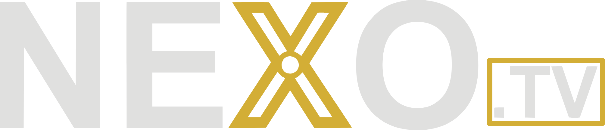

# 🎬 NEXO.TV | A Digital Film Heritage Concept



[](https://playnexotv.me)


[](https://app.netlify.com/projects/nexotv/deploys)

> **El cine que definió la historia** — Joyas ocultas, clásicos inmortales y el legado que las plataformas olvidaron.

---

## 🌐 Acceso Oficial
Puedes visualizar la interfaz en vivo y el catálogo actualizado en el siguiente enlace:
🚀 **[https://playnexotv.me](https://playnexotv.me)**

📚 **[Read the technical documentation](https://playnexotv.me/docs/index.html)**

---

## 📖 Sobre este Proyecto
Este repositorio es el resultado de un proyecto académico personal. El objetivo principal es demostrar habilidades en desarrollo web, gestión de bases de datos JSON y curaduría de contenidos digitales.

**Importante:** NEXO.TV no es una entidad comercial ni ofrece servicios de suscripción reales. Es una prueba de concepto (PoC) sobre cómo se puede estructurar una filmoteca digital moderna utilizando recursos legales y abiertos.

## 🚀 El Concepto
La idea detrás de NEXO es la **curaduría**. En un mar de archivos desordenados, NEXO actúa como un filtro de calidad:
* **Selección Histórica:** No subimos todo, solo lo que importa (*The Essentials*).
* **Valor Añadido:** Exploramos la creación de **"NEXO Originals"** mediante el doblaje, restauración 4K y montaje de obras libres de derechos.
* **UX/UI Cinematográfica:** Una interfaz diseñada para dar dignidad a películas que tienen más de 100 años.

## ✨ Características Técnicas (PoC)
* **NEXO Originals:** Demostración de contenido editado (como nuestra edición de *NEXO.TV: The Original Mickey Mouse Trilogy* de 1928).
* **Streaming Híbrido:** Integración directa con servidores de **Internet Archive** para catálogo general y **Hugging Face** para retransmisión estable de originales en FullHD/4K.
* **Arquitectura:** Diseño "Mobile First", catálogo dinámico desde Google Sheets y metadatos cinematográficos enriquecidos desde TMDB.
* **Preferencias locales:** Favoritos, progreso y consentimiento de cookies se guardan en el navegador mediante `localStorage`; no se requiere una cuenta.
* **Carga coordinada:** La pantalla inicial permanece visible hasta descargar el catálogo, completar el enriquecimiento TMDB y renderizar la interfaz.

## 🎞️ Catálogo Destacado (Essentials)
El proyecto incluye una selección de obras maestras que sirven para testear diferentes formatos y épocas:
1.  **Sin Novedad en el Frente (1930)**
2.  **Häxan (1922)**
3.  **El Chico (1921)**
4.  **Metrópolis (1927)**
5.  **Nosferatu (1922)**
6.  **Scarlet Street (1945)**

## ⚖️ Aspectos Legales
### Sobre NEXO.TV y el acceso a los contenidos

NEXO.TV es una biblioteca cinematográfica digital de carácter cultural e informativo, creada para facilitar el descubrimiento y el acceso a obras audiovisuales, especialmente cine clásico, histórico y de dominio público.

NEXO.TV no produce, posee ni almacena directamente las películas que aparecen en su catálogo. La plataforma reúne información cinematográfica procedente de TMDB, incluyendo carteles, sinopsis, reparto, dirección y otros datos, y la relaciona con enlaces a fuentes externas de reproducción, principalmente [Internet Archive](https://archive.org/) y, en el caso de determinadas obras originales, [Hugging Face](https://huggingface.co/).

Por tanto, NEXO.TV funciona como una interfaz de consulta y organización que facilita la localización de contenidos disponibles en Internet. La reproducción se realiza mediante fuentes externas, sin que NEXO.TV se presente como propietaria de los archivos audiovisuales enlazados.

### Nuestra filosofía: un modelo similar a Stremio

NEXO.TV comparte ciertos principios de funcionamiento con plataformas como [Stremio](https://www.stremio.com/), que permiten reunir información audiovisual y acceder a contenidos procedentes de distintas fuentes mediante una interfaz unificada.

Esta comparación describe una similitud de funcionamiento y no implica que ambas plataformas tengan idéntica estructura técnica, relación comercial o situación jurídica.

### Derechos de autor y propiedad intelectual

NEXO.TV no reclama la titularidad de ninguna película, cortometraje, documental, banda sonora, imagen o material audiovisual perteneciente a terceros.

La disponibilidad de una obra en Internet Archive u otra plataforma externa no constituye, por sí misma, una declaración de que dicha obra sea de dominio público o cuente con autorización para su distribución en todos los territorios.

NEXO.TV toma como referencia la normativa estadounidense sobre derechos de autor para sus criterios internos de catalogación, sin perjuicio de las leyes que puedan resultar aplicables en los territorios desde los que se acceda al servicio.

### Solicitudes de retirada

NEXO.TV respeta los derechos de los autores, productores, distribuidores y demás titulares de propiedad intelectual. Si un titular de derechos considera que una obra enlazada vulnera sus derechos, puede ponerse en contacto con el equipo de NEXO.TV mediante [nexotv.info@gmail.com](mailto:nexotv.info@gmail.com) o [davidjoseferreiro@gmail.com](mailto:davidjoseferreiro@gmail.com), identificando la obra y acreditando su relación con los derechos reclamados.

Las solicitudes serán revisadas y, cuando corresponda, NEXO.TV podrá retirar la entrada del catálogo, desactivar el enlace externo o adoptar otras medidas apropiadas.

### Acceso cultural

NEXO.TV es un proyecto independiente, sin ánimo de lucro y sin publicidad, cuya finalidad es facilitar el descubrimiento y la conservación de la cultura cinematográfica.

**NEXO.TV no pretende apropiarse del cine. Pretende hacerlo más accesible.**

---

## 🛠️ Tecnologías Utilizadas
* **Frontend:** HTML5, CSS3 (Custom Design), JavaScript (ES6+).
* **Hosting y funciones:** [Netlify](https://playnexotv.me), incluyendo la función serverless de TMDB.
* **External media sources:** Internet Archive para el catálogo general y Hugging Face para casos de obras originales. NEXO.TV no aloja esos archivos.
* **Catálogo editorial:** Google Sheets publicado como CSV.
* **Datos cinematográficos:** TMDB API v3.

### Fuentes de catálogo, TMDB y enlaces externos

El catálogo se lee desde la hoja publicada de Google Sheets configurada en `script.js`; `movies.json` ya no participa en la carga de la aplicación. Los campos curatoriales (vídeo, etiquetas y sinopsis) proceden de la hoja. Los identificadores `idTMDB` se usan para completar título, imágenes, nota, estreno, duración, año, géneros, director, reparto, productoras y países mediante la función `/.netlify/functions/tmdb`.

La prioridad de los datos es:

1. Los valores no vacíos de la hoja.
2. TMDB como respaldo o enriquecimiento.
3. La duración del vídeo cuando TMDB no proporciona `runtime`.

La nota y la fecha de estreno no se muestran si TMDB no devuelve datos. Las tarjetas Must See ya no forman parte del catálogo.

El enlace de vídeo de cada fila apunta a un servicio externo. NEXO.TV únicamente combina la referencia de TMDB con ese enlace en una interfaz pública; no descarga, almacena, controla ni reclama la propiedad de las obras enlazadas. Las solicitudes de retirada deben enviarse a [nexotv.info@gmail.com](mailto:nexotv.info@gmail.com) o [davidjoseferreiro@gmail.com](mailto:davidjoseferreiro@gmail.com).

### Columnas de Google Sheets

La pestaña publicada debe conservar estas columnas:

`idCatalogo`, `idTMDB`, `titulo`, `año`, `sinopsis`, `generos`, `director`, `reparto`, `productoras`, `paisesProduccion`, `posterURL`, `landscapeURL`, `videoUrl`, `isEssential`, `isOriginal`, `hasOscar`, `bestPictureWinner`, `bestPictureNominee`.

Después de editar la hoja, vuelve a publicarla desde **Archivo → Compartir → Publicar en la web → Volver a publicar**. La aplicación fuerza una petición sin caché al cargar.

Configura en Netlify la variable de entorno `TMDB_READ_TOKEN` con un token de lectura de API de TMDB. No incluyas ese token en el frontend ni en el repositorio.

La función se encuentra en [`netlify/functions/tmdb.js`](netlify/functions/tmdb.js) y se consulta mediante `/.netlify/functions/tmdb?ids=ID1,ID2`. Para desplegar:

```powershell
netlify env:set TMDB_READ_TOKEN "TU_TOKEN"
netlify deploy --prod
```

### Documentación web

La documentación navegable del proyecto está en [`docs/index.html`](docs/index.html). Cuando un cambio modifique datos, flujo de carga, integración TMDB, Netlify o UX, actualiza esa página y la fecha de actualización antes de desplegar.

## 👤 Autor
Desarrollado por **David Ferreiro**.

---
*Este proyecto es una carta de amor al cine clásico y al desarrollo de software.*